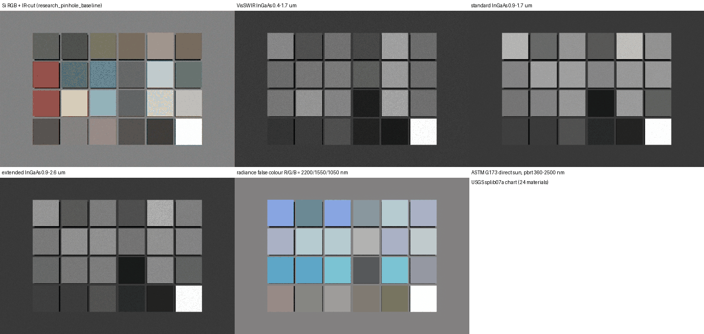

# Short-wave infrared (SWIR, to 2.5 um)

Opt-in support for InGaAs SWIR cameras: a 360-2500 nm pbrt build, InGaAs QE models, SWIR
illuminants, and material / water / ice data extended to 2.5 um. Visible and NIR defaults are
unchanged.



## Build and render

```bash
PBRT_NATIVE=OFF PBRT_LAMBDA_MAX_NM=2500 PBRT_BUILD_DIR=third_party/pbrt-v4/build-swir tools/build_pbrt.sh
python tools/build_colorchecker_scene.py --out-dir scenes/swir_chart --patch-dir spectra/usgs_nir \
  --film spectral --illuminant spectra/illuminant/swir/sun_astm_g173_direct.csv --radiometric-light \
  --lambda-max 2500 --pbrt-lambda-max 2500 --spectral-lambda-max 2500 --spectral-nbuckets 214
mkdir -p scenes/swir_chart/out && (cd scenes/swir_chart && ../../third_party/pbrt-v4/build-swir/pbrt colorchecker.pbrt)
python tools/apply_emva_noise.py --camera-model-config config/camera_recipes/swir_ingaas_vga_15um.yaml \
  --linear-exr scenes/swir_chart/out/colorchecker_spectral.exr \
  --scene-manifest-json scenes/swir_chart/colorchecker_manifest.json --auto-exposure --raw-out scenes/swir_chart/raw.raw
```

`PBRT_LAMBDA_MAX_NM` is the existing patch-0002 macro; `--radiometric-light` is needed because
pbrt's photometric light normalisation divides by a luminance that is ~0 for SWIR emitters. With
broad SWIR QE the spectral film needs more samples than a visible render (the demo uses 1024 spp;
64 spp leaves visible spectral grain). The extended-InGaAs tail beyond 2500 nm (~10 % of its
response) is cut by the film; build with `PBRT_LAMBDA_MAX_NM=2600` if it matters.

## Detectors (`tools/swir_spectra.py` -> `spectra/QE/swir/`)

Model, not measurement: In(1-x)Ga(x)As bandgap from the Vurgaftman et al. (2001) Varshni and
bowing parameters, direct-gap `sqrt(E - Eg)` absorption with an Urbach tail, an InP window
(cap / substrate) that sets the ~0.9 um cut-on, AR reflectance 3 % and a constant collection
efficiency. Parameters were fitted to Hamamatsu PIN photodiode datasheets (G12180, G12183) and
are checked in `tests/test_swir.py`:

| QE curve | composition | model | datasheet |
|---|---|---|---|
| `QE_ingaas_standard` | In0.53Ga0.47As, 3 um InP window | 1.10 A/W at 1.55 um; 10 % points 892-1708 nm (25 C), 1672 nm (-20 C) | G12180: 1.1 A/W typ. at 1.55 um, 0.9 at 1.3 um; 0.9-1.7 um (25 C), 1.65 um (-20 C) |
| `QE_ingaas_visswir` | same, substrate removed, 20 nm cap | same SWIR, QE ~0.8 at 500 nm | visible response is an assumption (IMX990-class), not fitted |
| `QE_ingaas_extended` | In0.81Ga0.19As, 0.5 um window | 1.30 A/W at 2.3 um; 10 % point 2626 nm (25 C), 2554 nm (-20 C) | G12183: 1.3 A/W typ. at 2.3 um, 0.4 A/W at 0.9 um; 0.9-2.6 um (25 C), 2.55 um (-20 C) |

`InGaAsDetector.qe(lam, temp_c)` gives other temperatures (the cutoff moves ~0.6 nm/K).

## Sensors (`config/sensor_models/swir_*.yaml`, recipes of the same name)

Monochrome sensors use a 1x1 `cfa.layout: [[S]]` (the generic CFA path, no IR-cut filter):

| recipe | pitch | full well / read noise | dark current |
|---|---|---|---|
| `swir_ingaas_vga_15um` | 15 um, TEC 15 C | 150 ke- / 45 e- | 7e4 e-/s at 20 C (~5 nA/cm^2), x2 per 8 C (G12180 1.09x/C) |
| `swir_ingaas_visswir_5um` | 5 um | 5 ke- / 30 e- | scaled from the 15 um model by area |
| `swir_ingaas_extended_15um` | 15 um, TEC -60 C | 1.2 Me- / 150 e- | G12183-210KA-03 (6.4 uA/cm^2 at -20 C, 1.067x/C) -> 6.7e6 e-/s |

Noise and full-well values are representative of the class, not a specific camera. Recipes use
the pinhole lens: the glass lens models' transmission is not validated past 1.1 um.

## Spectra

* **Sun** -- ASTM G173-03 (SMARTS 2.9.2, AM1.5, 280-4000 nm), from pvlib's BSD-3 copy
  (`spectra/illuminant/swir/ASTMG173.csv`); `sun_astm_g173_{direct,global}.csv` are 1 nm
  resamples, with the 1.38 / 1.87 um water-vapour bands.
* **Tungsten** -- Planck 2856 K (`tungsten_2856K.csv`). LEDs have no SWIR emission.
* **Materials** -- the 24 USGS splib07a chart curves (`spectra/usgs_nir`) now run 350-2500 nm
  (public domain); leaves show the 1.45 / 1.94 um liquid-water dips.
* **Water** -- Segelstein (1981) n, k at 25 C, 350-2600 nm (`spectra/water/segelstein_1981_nk.csv`,
  refractiveindex.info, CC0). `tools/fog_mie.py` uses it above 1100 nm; its 350-1100 nm table is unchanged.
* **Ice** -- Warren & Brandt (2008) extended from 1200 to 2600 nm (`spectra/ice/warren_brandt_2008.csv`).

## Not yet SWIR-aware

The CIE daylight sky stops at 830 nm (the Prague SWIR dataset, 280-2480 nm, is user-downloaded;
see `tools/prague_sky.py`), atmospheric water-vapour absorption along scene paths, vehicle / road /
skin / snow materials, lamp spectra in the highway scenes, and lens glass / coating transmission.
